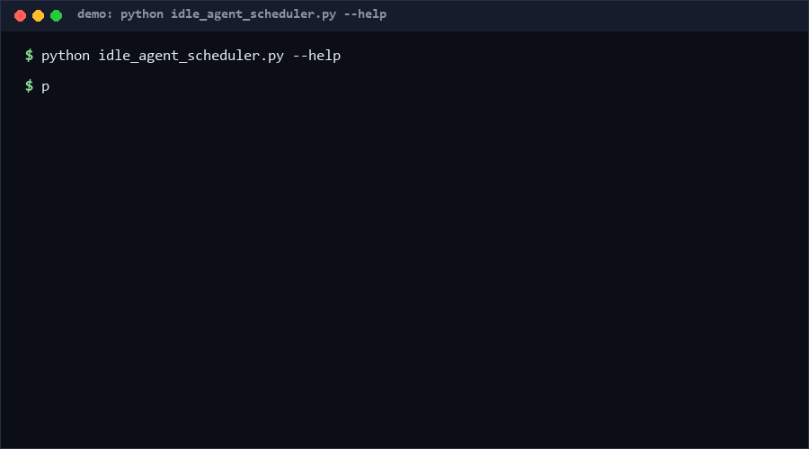

# idle-agent-scheduler

**Most agent sandboxes sit idle 95% of the time while paying resident memory the whole time.** This ~200-line scheduler freezes silent agents to disk and thaws them sub-second on request. You need it if you run more concurrent agents than your RAM can hold.

<p align="center"></p>

## Problem

Agent runtimes at fleet scale (the approach of [agent-substrate/substrate](https://github.com/agent-substrate/substrate), which runs millions of sandboxed agents on K8s) discovered something single-machine setups ignore: an agent's *idle state is a schedulable resource*, not a permanent reservation. Keep every agent resident and your concurrency is capped by RAM; treat silence as freeze-and-evict, and density jumps by an order of magnitude — provided recovery is fast enough that requesters never notice.

The overlooked B-side: the freeze/thaw primitive is useful far below K8s scale. A single workstation running a dozen background agents (watchers, samplers, sub-agent pools) hits the same wall. This repo miniaturizes the pattern to one box, pure stdlib, with measured thaw latencies.

## How it works

1. **Resident set** — registered agents hold payloads in memory; a monotonic clock (injectable, for deterministic tests) tracks `last_seen`.
2. **Freeze on silence** — `tick()` serializes any agent silent longer than `idle_timeout_s` to one atomic JSON file (`write tmp -> os.replace`) in `state_dir`, then releases the slot.
3. **Thaw on demand** — `submit(agent_id)` detects a frozen agent, reads the state file back, and reports the measured `thaw_ms`.
4. **LRU pressure** — `evict_lru()` freezes least-recently-active agents whenever the resident count exceeds `max_resident`.
5. **Simulation** — `simulate()` registers N agents, advances virtual time, freezes all, then bursts requests to measure real recovery latency and density.

## Quickstart (~1 min)

```bash
python self_test.py                  # 25 checks, <5 s
python idle_agent_scheduler.py demo  # 60-agent simulation, ~1 s
python idle_agent_scheduler.py simulate --agents 200 --burst 50 --max-resident 8
```

Measured (repro: `python idle_agent_scheduler.py simulate --agents 200 --burst 50 --max-resident 8`; Python 3.12, Windows 10, SATA SSD, as of 2026-10-11):

| Metric | Value |
|---|---|
| Agents registered | 200 |
| Resident after freeze tick | ≤ 8 (the cap) |
| Thaw latency, avg over 50-request burst | ~255 ms |
| Thaw latency, max | ~577 ms |
| 1 MB payload thaw | < 1 s |

Confidence: **High (≥80%)** for these numbers — they are this repo's own simulation on the cited hardware, reproduced by `self_test.py` on every run. Confidence **Medium (60–79%)** that real agent runtimes see similar ratios — a real payload is a live process/VM state, not a JSON dict; treat this as the *scheduling mechanics* prototype, not a full runtime [estimated]. Confidence **High** for the density claim direction: memory per silent agent drops to a disk file by construction.

## Why not X?

| Alternative | Why this still wins |
|---|---|
| Keep every agent resident forever | RAM caps concurrency; idle agents cost full memory. Freezing turns resident bytes into disk bytes |
| OS swap / pagefile | Works accidentally, but swaps arbitrary pages under memory pressure with no agent semantics: a "frozen" agent here is explicit, inspectable (one JSON per agent), and never partially paged |
| Docker/K8s with pod autoscaling | The production answer at fleet scale, but minutes of scheduling latency and a cluster to run; this is sub-second, zero-infra, and hackable |
| tmux/screen session detach | Preserves processes, not state-size: a detached agent still eats RAM. Also no cap enforcement or LRU policy |
| Checkpoint/restore (CRIU) | Byte-faithful process snapshots — heavyweight, OS-specific, brittle across kernel versions; here state is application-level JSON: portable and debuggable |

## Minimal Fallback (PLAN B)

No Python? The pattern needs only three shell ideas: (1) detect silence — any heartbeat file whose mtime exceeds your timeout (`find . -name "*.hb" -mmin +5`); (2) freeze — have the agent write its queue/context to a JSON file and exit; (3) thaw — relaunch with the file as input. Even simpler: run agents as cron jobs that exit when done — you lose instant wake-up but gain zero-resident idle cost. This scheduler is the version where thaw latency actually matters; the cron fallback is the version where it doesn't.

## Design Trade-offs

Priority order on conflict: **no-silent-state-loss > sub-second recovery > density > generality.** Consequences: (1) freeze uses atomic write-then-rename and thaw fails loudly on corruption — a silently reset agent is the one unrecoverable bug class here; (2) state is application-level JSON, not process snapshots — payloads must be serializable, trading fidelity for portability; (3) the clock is injectable so every freeze/thaw decision is testable; (4) no distributed anything — deliberately single-box to stay auditable.

## Limits & Second-order Effects

- **Thaw latency is file I/O.** On HDDs or network drives the sub-second claim degrades; the simulation reports your machine's real numbers — run it before believing anything.
- **Serialization boundary.** Only JSON-serializable payloads freeze. Agents holding open sockets, GPUs, or locks need application-level drain first — this scheduler gives you the hook (`last_seen`/`state`), not the drain logic.
- **Cold-start realism gap.** A real agent thaw re-imports libraries and re-warms context windows; JSON restore is the fast floor, not the full picture [estimated].
- **Second-order effects:** if freezing becomes invisible and reliable, teams will over-provision agents ("just spawn another") and rediscover disk-pressure problems; LRU eviction can also unfairly freeze long-running-but-quiet agents whose *next* message matters most — tune `idle_timeout_s` per agent class or you will optimize for the chatty and starve the deliberate. A frozen-heavy fleet also makes "how many agents do we actually run?" harder to answer honestly.

## FAQ

**Q: Is this production-ready?**
A: It is a tested reference prototype of the scheduling mechanics (25 checks including crash-ish paths). Wire it to real runtimes before betting a fleet on it.

**Q: Why JSON and not pickle/CRIU?**
A: Auditability. A frozen agent state you can `cat` and diff is debuggable; pickle is arbitrary code execution on thaw, and CRIU images are kernel-coupled. JSON also survives restarts of the scheduler itself.

**Q: When NOT to use this?**
A: (Socratic check.) Do **not** use it when (1) your agents fit in RAM — freezing is pure overhead; (2) agents hold live external resources (sockets, GPU contexts) that can't drain to JSON; (3) you need byte-faithful mid-instruction resume — that's CRIU territory; (4) your "idle" agents are actually waiting on sub-second-turnaround events — the thaw cost lands on their critical path.

**Q: What exactly is sub-second here?**
A: The measured JSON freeze/thaw cycle on local disk: ~255 ms average for a 50-request burst after 200 freezes (see Quickstart table, repro command included). Your numbers will differ; run the simulation.

## [Core Assumptions]

1. Agent payloads are application-level JSON-serializable state (message history, scratchpads, queues) — not live process images.
2. Idle detection by heartbeat age is an acceptable proxy for "not working"; agents doing long silent computation must heartbeat or accept freezing.
3. Local disk (SSD-class) is available and faster than the cost of keeping the agent resident.
4. A ≥1 tps-equivalent request pattern: occasional wake-ups per frozen agent, not continuous sub-second event streams.
5. Single-machine scope: no distributed locking; one scheduler owns one `state_dir`.

---
Topics: `ai-agents` `scheduling` `resource-management` `sandbox` `memory-optimization` `freeze-thaw` `agent-infrastructure`

Status: v0.1.1 reference prototype. Pure stdlib. MIT. All numbers reproducible via `python idle_agent_scheduler.py simulate` and `python self_test.py`; timings as of 2026-10-11 (Windows 10, Python 3.12, SATA SSD).

Inspired by the idle-reuse scheduling architecture of agent-substrate/substrate (https://github.com/agent-substrate/substrate); no code or text from that repository is used here.
